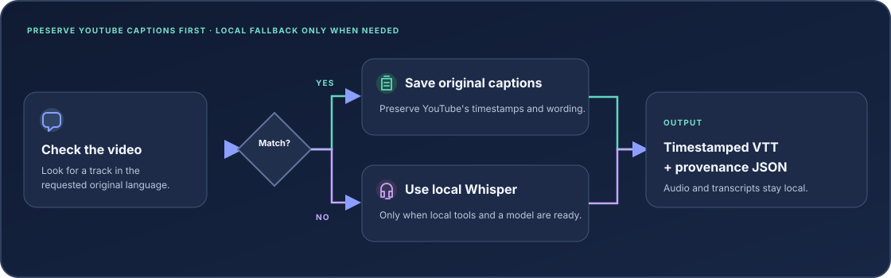

<div align="center">

# YouTube Transcript

**Get the captions YouTube already has. Keep their timestamps and wording.**

If the requested original-language captions are unavailable, use an optional local Whisper fallback.

[](https://github.com/shubinlab/youtube-transcript/actions/workflows/ci.yml)
[](LICENSE)
[](#compatibility)

</div>

## Install

One command installs the latest release and prepares the YouTube caption runtime. Existing supported runtimes are reused. Missing user-level components are downloaded only when needed; no system package manager or administrator access is used.

```bash
curl -fsSL https://raw.githubusercontent.com/shubinlab/youtube-transcript/main/install.sh | bash
```

The installer checks that the command starts and that YouTube-caption prerequisites are ready. It does not install speech-recognition tools or download model weights.

To update to the latest release, run the same install command again. To remove the CLI:

```bash
curl -fsSL https://raw.githubusercontent.com/shubinlab/youtube-transcript/main/uninstall.sh | bash
```

## Use

```bash
youtube-transcript 'https://www.youtube.com/watch?v=VIDEO_ID'
```

Russian is the default language. Choose another spoken language and an output folder with `-l` and `-o`:

```bash
youtube-transcript -l en -o ./transcripts 'https://www.youtube.com/watch?v=VIDEO_ID'
```

Check readiness without contacting YouTube:

```bash
youtube-transcript --check
```

## What it does

<div align="center">



</div>

| Video has… | Result |
| --- | --- |
| A manual track in the requested language | Save that original track |
| No manual track, but an original-language automatic track | Save that automatic track |
| No matching track | Use local Whisper if it is installed and a multilingual model is available |

Translated tracks and live chat are not treated as original speech. The tool does not rewrite, deduplicate, or merge YouTube's rolling caption cues.

## Files created

Each successful run creates two files in the output folder:

| File | Contents |
| --- | --- |
| `<video-id>.vtt` | Original timestamped YouTube captions or local ASR output |
| `<video-id>.transcript.json` | Source, language, duration, cue coverage, tool provenance, and VTT SHA-256 |

Existing files are preserved. Add `--force` only when you intend to replace that video's files. Same-video runs are serialized to prevent mixed outputs.

To compare local ASR with YouTube's captions, keep the result in a separate folder:

```bash
youtube-transcript --force-asr -o ./local-asr 'https://www.youtube.com/watch?v=VIDEO_ID'
```

Agreement between transcripts is a review signal, not proof of accuracy.

## Compatibility

| Platform | Caption retrieval | Local ASR |
| --- | --- | --- |
| Linux x86_64 / ARM64, glibc 2.27+ | Supported by the installer | Install FFmpeg, `whisper-cli`, and a multilingual model separately |
| macOS Intel / Apple Silicon | Supported by the installer | Install FFmpeg, `whisper-cli`, and a multilingual model separately |
| Windows | Not supported by this installer | Not tested |

Use an archived YouTube video. Active and upcoming live streams are rejected. Network access is needed to retrieve captions or audio; local ASR itself does not upload media.

## Optional local speech recognition

Local ASR is used only when no suitable YouTube caption track exists, or when `--force-asr` is set. It requires FFmpeg, `whisper-cli`, and an existing multilingual Whisper model. The normal installer does not install these tools or download model weights.

See [installation and recovery](docs/INSTALLING.md) for supported setup paths, diagnostics, and dependency details.

## Privacy and limits

- YouTube caption and audio retrieval use the installed downloader and contact YouTube.
- Audio and transcripts stay local; this tool does not use a cloud ASR service.
- The tool does not read browser cookies, authenticate to private videos, bypass access restrictions, translate captions, or identify speakers.
- YouTube captions and local ASR can both be wrong. The metadata records provenance and timeline coverage, not recognition accuracy.

## Project

- [Changes](CHANGELOG.md)
- [Contributing](CONTRIBUTING.md)
- [Security](SECURITY.md)
- [MIT license](LICENSE)
